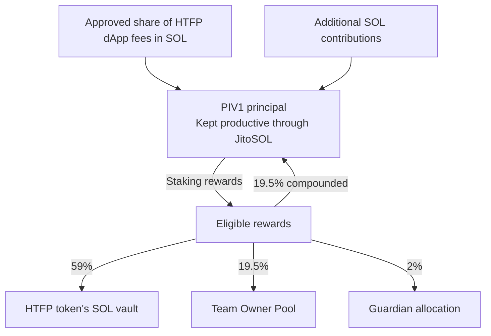

# PIV1

## Perpetual Income Vault 1

**Keep the principal. Put the staking rewards to work.**

A **Perpetual Income Vault (PIV)** keeps a pool of capital staked and directs all or part of its staking rewards to destinations defined by its creator. The principal is not a spending budget: it is the productive base intended to keep supporting those destinations over time. New contributions can increase it, and retaining part of the rewards can grow it further.

**PIV1 is the first Perpetual Income Vault in the HTFP ecosystem. Its main purpose is to feed the SOL reserve backing the `$HTFP` token.** It is designed to turn a share of the ecosystem's activity into lasting productive capital, rather than spend that revenue once and start again.

**[Understand the concept and PIV1](docs/PIV1_OVERVIEW.md)** · **[Explore the technical architecture](docs/PIV1_TECHNICAL_ARCHITECTURE.md)** · **[Follow Testnet progress](docs/PIV1_M5_TESTNET_READINESS.md)**

> **Development status:** Deployed on Solana Testnet; validation is ongoing. The complete delayed-withdrawal lifecycle of the deployed program remains unvalidated on the public cluster. This documentation is not a Mainnet-ready release.

## From ecosystem activity to lasting capital

The intended flow is straightforward. HTFP dApps send an individually approved share of their fees to PIV1. **The whole share received by PIV1 becomes principal**, not immediately distributable income. Other SOL contributions can reinforce the same capital base. This does not mean every dApp sends all its fees, or that future dApp revenue already exists.

PIV1 receives SOL and puts eligible principal to work through **JitoSOL**, the liquid staking token selected for this implementation. As staking rewards accrue, PIV1 separates the value of its principal from the rewards available for distribution. It directs part of those rewards to the `$HTFP` SOL vault, part to the team, part to its guardians, and retains part as additional principal.

*Economic flow, not transaction order. The percentages apply to eligible gross rewards, not incoming contributions. Withdrawal costs and rounding affect net payments.*

**PIV1 and the `$HTFP` SOL vault are two different things.** PIV1 holds the productive principal. The token's SOL vault receives a share of the rewards. Adding SOL to that reserve supports the token's backing mechanism; it does not guarantee a market price or a dollar-denominated floor.

## Why compound?

PIV1 is designed to build principal from two sources: new receipts from ecosystem activity or other contributions, and the rewards it retains instead of distributing.

That larger principal is intended to support larger future rewards **under comparable staking conditions**. The aim is a growing source of support, not a treasury gradually emptied by its own payments. More principal does not guarantee more rewards in every period: staking rates and protocol conditions can change.

## JitoSOL is our implementation, not the definition of a PIV

The concept can use native staking or a suitable liquid staking token. **This PIV1 uses JitoSOL on Solana.** It converts eligible SOL through Jito's stake pool and accounts for rewards in SOL. JitoSOL reflects staking rewards through its SOL redemption value; it is not a separate fixed-interest promise. See [Jito's explanation](https://www.jito.network/docs/jitosol/faqs/technical-faqs/).

Native staking or another LST would require its own integration and checks. They are alternatives for a PIV design, not interchangeable options already enabled in PIV1.

## Why guardians in a perpetual vault?

The ambition is to build for decades, potentially much longer. That does not mean assuming today's JitoSOL implementation or Solana rules can never change.

PIV1 therefore retains a **six-key Squads governance system requiring four approvals, with no mandatory timelock**. Its intended purpose is continuity: react to a serious problem, repair an integration or migrate away from a staking technology that is no longer suitable. **The preferred outcome is that a sound vault never needs its rules changed.** Ordinary distributions do not require guardian approval.

This is a real trade-off, not an absolute lock against governance. The 4/6 authority can upgrade the whole program and change its rules; its powers are not technically limited to emergencies. The founder may initially control all six keys, which is not independent six-person governance.

## What the mechanism does not promise

The design preserves principal under its normal rules and distributes only eligible rewards. It cannot guarantee the integrity or lifetime of Solana, JitoSOL or the program itself. Its accounting safeguards do not insure assets against loss.

Rewards depend on staking conditions, and amounts denominated in SOL can gain or lose value in dollars. Contributions to PIV1 create no individual withdrawal right or personal entitlement to rewards. Transactions still need someone to submit them; permissionless does not mean self-executing.

## Use the idea beyond HTFP

Anyone can build around the same principle: **keep a principal staked, grow it where possible, and use its rewards for a chosen purpose**. Other projects can choose different beneficiaries, reward splits, governance or staking integrations. PIV1 is HTFP's first application of that idea, not a claim that every PIV must use JitoSOL or serve a token reserve. Concept reuse is distinct from reusing repository code under its applicable license terms.

## Development and verification

The [7 November 2026 repository checkpoint](https://github.com/HoldTheFuckingPosition/PIV1/tree/58e1d2fbbd8d8ab599bc3f16b553cb36ac7920c0) records finalized staking, a liquid-funded distribution, beneficiary settlement, contribution integration and strict partial restaking. **Public delayed-withdrawal validation is still open.** Publishing these explanations does not mark the remaining tests complete or authorize Mainnet deployment.

For the implementation, start with the [technical guide](docs/PIV1_TECHNICAL_ARCHITECTURE.md), [master specification](docs/PIV1_MASTER_SPEC.md), [decision register](docs/PIV1_DECISIONS.md), [program](programs/piv1/README.md), [CLI](clients/cli/README.md) and [test plan](docs/PIV1_TEST_PLAN.md).

<strong>Detailed status and development history</strong>

The [readiness register](docs/PIV1_M5_TESTNET_READINESS.md) and [pilot checkpoint](docs/PIV1_PILOT_STATE.md) retain the results, failures and remaining conditions. The [complete earlier README](https://github.com/HoldTheFuckingPosition/PIV1/blob/58e1d2fbbd8d8ab599bc3f16b553cb36ac7920c0/README.md) is preserved at its exact commit. Older dated checkpoints describe their historical scope, not the latest state.

