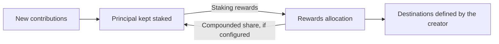

# Understanding PIV1

## Preserve the principal. Use the rewards. Build for the long term.

[Repository home](../README.md) · [Technical architecture](PIV1_TECHNICAL_ARCHITECTURE.md)

**PIV** means **Perpetual Income Vault**. **PIV1** is the first such vault in the HTFP ecosystem, with a specific job: generating a continuing source of SOL for the reserve backing the `$HTFP` token.

To understand PIV1, start with the mechanism, not the Solana accounts or the name of a staking provider.

## 1. What is a Perpetual Income Vault?

A Perpetual Income Vault is a mechanism that keeps a principal staked and uses the rewards it generates to fund destinations defined in the program. Those destinations are chosen when the creator designs the vault: they might be a project's reserve, an application, a team or another purpose.

**The principal is the productive base. The staking rewards are what can be distributed.** The normal operating rules do not let beneficiaries consume that base to keep payments going. A PIV may distribute all eligible rewards, or retain a portion to compound into principal. It can also accept fresh contributions, adding to the amount working for the future.

Think of the distinction this way: a spending treasury uses the money it holds; a PIV is designed to keep its capital working and use what that capital produces.



*This describes the generic principle. The staking asset, allocation rules, recipients and governance belong to each implementation.*

“Perpetual” expresses the intention to preserve that productive base indefinitely rather than spend it down or end it on a fixed maturity date. It is not a promise that a blockchain, a staking provider or a program can never fail.

## 2. What makes this one PIV1?

PIV1 is HTFP's first implementation of that mechanism. Its central purpose is to **increase the SOL reserve supporting the `$HTFP` token**, using staking rewards rather than consuming the principal that generates them.

The intended ecosystem connection is simple. HTFP builds dApps. Each participating dApp sends a separately approved share of its fees to PIV1. **All of that share received by PIV1 is added to principal.** It is not split between the token vault and the team as soon as it arrives.

That distinction matters. A share of a dApp's activity is intended to build productive capital that can keep supporting the ecosystem later, instead of financing only a one-off payment. The size of each dApp's contribution is defined individually; there is no universal fee percentage, and planned future income is not treated as money already received. Additional SOL contributions can strengthen the same principal.

There are two separate vaults:

| Vault | Its role |
| --- | --- |
| **PIV1** | Holds productive principal and allocates eligible staking rewards. |
| **The `$HTFP` SOL vault** | Receives a share of those rewards as funding for the token's reserve. |

PIV1 is not the token's mint or its trading market. Funding the reserve supports the token's backing mechanism, but does not by itself guarantee its market price, a price increase or a dollar-valued floor. The token's own rules are a separate component.

## 3. The simple PIV1 flow

**SOL comes in.** The economic value received is added to the capital intended to remain in the vault. A new contribution is not counted as a staking reward.

**The capital is put to work.** PIV1 converts eligible SOL into JitoSOL through Jito's stake pool. JitoSOL is the liquid staking token selected for this implementation: it represents a position in staked SOL, with rewards reflected in its SOL redemption value. PIV1 measures its principal and eligible rewards in SOL, not dollars.[^jito]

**Rewards are allocated.** The current design uses the following gross allocation:

| Destination | Share | Why it exists |
| --- | ---: | --- |
| `$HTFP` SOL vault | **59%** | Reinforce the token's SOL reserve. |
| PIV1 principal | **19.5%** | Retain rewards as additional productive capital. |
| Team Owner Pool | **19.5%** | Fund the project's designated team recipient. |
| Active guardians | **2%** | Provide the guardian allocation under the KIF activity rules. |

**The process continues.** The retained share becomes principal alongside new receipts. The outgoing shares are settled in SOL when the program's distribution conditions are met.

These percentages apply to eligible gross rewards, not incoming fees or contributions. Protocol withdrawal costs reduce the outgoing amounts, and rounding is conservative. The technical guide explains the exact net calculations and guardian carry rules. If no guardian is active, half of the available guardian allocation is compounded and the remainder is carried forward; inactive guardians do not receive personal rewards for that period.

The important distinction is **new receipts build principal; rewards fund the selected destinations and further compounding**. The Team Owner Pool and the `$HTFP` SOL vault are separate recipients, not interchangeable names.

<details>
<summary>A detail about the economic flow and the actual transfers</summary>

“SOL comes in and becomes staked principal” is the economic model, not a claim that every incoming lamport is immediately converted. PIV1 accounts for new receipts separately before integration. When an already-earned reward distribution needs SOL, it can use available incoming SOL and retain an equivalent value of existing staking rewards as principal. The entire contribution value still increases the principal accounting; new money does not manufacture new rewards or increase the amount eligible for distribution.

PIV1 also accepts direct JitoSOL contributions. That is an additional supported entry path, not the main idea someone needs to understand the vault.

</details>

## 4. How the principal is intended to grow

PIV1 combines **external additions** and **internal compounding**. Participating dApps and other contributors can add SOL. Separately, part of the vault's own rewards is retained instead of paid out. Both reinforce the capital base.

The normal economic policy can be summarized as:

```text
Existing principal
+ new contributions and the dApp fee shares actually received
+ rewards retained as principal
= a larger productive base
```

That is the reason for preserving principal rather than spending it: **under comparable staking conditions, a larger staked base can generate more rewards for the same destinations**. The mechanism aims to accumulate support over time instead of repeatedly starting from zero.

It can continue generating rewards even during a period with no new dApp receipts, provided the capital remains productive and the staking system continues operating. New receipts help it grow; they are not supposed to disguise themselves as yield.

This is a growth objective, not a steadily rising payout guarantee. A larger principal combined with a lower staking rate can produce fewer rewards. A protocol loss can also reduce the actual assets. PIV1's accounting does not normally lower its protected principal reference after a loss: recovery below that reference is not treated as new distributable income. The detailed mechanism is called the **high-water mark**.

## 5. Why JitoSOL? Could a PIV use native staking?

**JitoSOL is a technical choice made for PIV1, not a requirement of the PIV concept.** A PIV can be designed around native staking or a suitable liquid staking token on a staking-enabled network.

Native Solana staking delegates SOL through stake accounts. Liquid staking instead provides a token representing a pooled staking position. PIV1's chosen JitoSOL route lets it hold that position as a token and use the pool's on-chain SOL accounting to distinguish principal from eligible rewards. Its normal entry is a direct stake-pool deposit, not a trade on a decentralized exchange.[^native][^entry]

This does not establish that JitoSOL is the only possible choice or that it is universally better than native staking. It adds a dependency on Jito's pool and its rules. Another LST or native staking would need its own withdrawal handling, accounting and security review. **PIV1 is not currently a menu of interchangeable staking strategies.**

Someone implementing another PIV can make a different choice. The common principle remains the same: preserve productive capital and direct its rewards to a purpose.

## 6. Why keep guardians instead of making PIV1 immutable forever?

The intended horizon is decades, potentially centuries. That ambition makes it especially difficult to assume that today's staking technology will remain suitable and unchanged for the entire lifetime of the vault.

PIV1 therefore keeps an upgrade path under **six governance keys with four required approvals, using Squads and no mandatory timelock**. Guardians are intended to provide continuity if a serious bug, an external protocol change or an LST failure requires intervention. A justified upgrade could change the integration or migrate to a different staking approach.

**The desired outcome is that the vault keeps operating without needing its rules rewritten.** Guardians are not there to manually approve each ordinary distribution or routinely redirect the economic model. Normal execution is permissionless: an external caller can submit an eligible transaction, and the program checks the rules.

But the retained authority is powerful. The existing 4/6 quorum can upgrade the whole program, not just repair an approved list of bugs. Its ability to change code is not technically restricted to emergencies. Initially the founder may control all six keys; separate keys alone do not mean six independent people.

That is the explicit compromise: a route to adapt over a very long lifetime, in exchange for a governance trust assumption. Neither guardians nor upgrades guarantee that a loss can be prevented or recovered.

## 7. What depends on things outside PIV1?

**Staking conditions.** PIV1 does not set Solana's staking reward rate. Network rules, the amount staked, validator performance and fees can change the rewards available. Jito-specific operation and fees also matter. None of these is a fixed interest rate promised by PIV1.[^staking]

**The value of SOL.** Principal and rewards are accounted for in SOL. More SOL does not necessarily mean more dollars: the market value of SOL is independent of the vault's accounting.

**Technology and governance.** Bugs, external protocol failures, compromised keys or an unsafe upgrade can interrupt the mechanism or cause loss. A rule that protects principal in normal operation is not insurance for that principal.

**Execution and timing.** A program does not wake up and send a transaction by itself. Someone must call it. PIV1's current rules require at least ten days between successful distribution preparations, and a direct staking withdrawal can add protocol delays or minimum-amount constraints. There is no promise of a payment every ten days.

**Future ecosystem activity.** Planned dApps may or may not generate revenue. Principal growth from their fees depends on actual activity and actual receipts, not a projection.

Contributing to PIV1 does not create an individual claim on its capital or rewards. It is a contribution to the mechanism, not a personal staking account with a withdrawal button.

## 8. A concept others can use

The principle is not limited to HTFP, JitoSOL or a token reserve. Anyone can design a PIV for a different purpose, choosing its beneficiaries, retained reward share, staking integration and authority model. An implementation might support a community project, an application or a long-lived operating reserve.

PIV1 documents one concrete implementation and its trade-offs. It is not a universal deployment template, and another project's choices require their own validation. Using the idea is distinct from copying repository code, whose reuse depends on the applicable license terms.

## 9. Where PIV1 stands

This overview is published while development continues. The repository's **7 November 2026 checkpoint** records deployed Testnet code and successful staking, a liquid-funded distribution, beneficiary settlement, contribution integration and strict partial restaking. **The deployed program's complete delayed-withdrawal lifecycle remains unvalidated on the public cluster.** Those are recorded results, not a new live-chain observation performed for this editorial update.

For current progress, read the [Testnet readiness register](PIV1_M5_TESTNET_READINESS.md). For how the mechanism is implemented and checked, read [PIV1 Technical Architecture and Design Decisions](PIV1_TECHNICAL_ARCHITECTURE.md). The [master specification](PIV1_MASTER_SPEC.md) and [decision register](PIV1_DECISIONS.md) retain the exact rules; this overview is not an audit or a declaration of Mainnet readiness.

---

**The idea in one sentence:** Build a principal intended to last, keep it productive, and let its staking rewards support the purpose it was created for.

### Sources and scope

PIV1 rules and the recorded Testnet status are grounded in repository snapshot [`58e1d2f`](https://github.com/HoldTheFuckingPosition/PIV1/tree/58e1d2fbbd8d8ab599bc3f16b553cb36ac7920c0), including its [master specification](https://github.com/HoldTheFuckingPosition/PIV1/blob/58e1d2fbbd8d8ab599bc3f16b553cb36ac7920c0/docs/PIV1_MASTER_SPEC.md), [decisions](https://github.com/HoldTheFuckingPosition/PIV1/blob/58e1d2fbbd8d8ab599bc3f16b553cb36ac7920c0/docs/PIV1_DECISIONS.md) and [recorded results](https://github.com/HoldTheFuckingPosition/PIV1/blob/58e1d2fbbd8d8ab599bc3f16b553cb36ac7920c0/README.md). The founder's 8 November clarification supplies the concept-first explanation and approval to publish during ongoing Testnet validation. No new economic rule or KIF acronym expansion is introduced.

[^jito]: [Jito: token mechanics and rewards](https://www.jito.network/docs/jitosol/faqs/technical-faqs/).
[^native]: [Solana: native staking](https://solana.com/docs/references/staking).
[^entry]: [Jito: staking SOL for JitoSOL](https://www.jito.network/docs/jitosol/get-started/stake-sol-for-jitosol-flow/overview/).
[^staking]: [Solana: staking and inflation](https://solana.com/staking).
