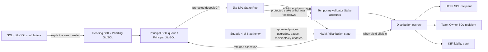
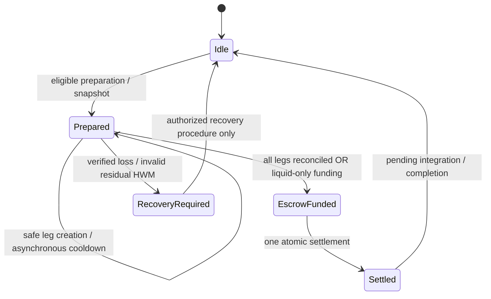

# PIV1 Technical Architecture and Design Decisions

[Repository home](../README.md) | [Understanding PIV1](PIV1_OVERVIEW.md)

**New direction D107 — 8 November2026:** the founder selects planned Jupiter liquidity for positive distribution shortfalls below1.5SOL and retains delayed withdrawal at/above1.5SOL. The [Phase A design](PIV1_HYBRID_LIQUIDITY_DESIGN.md) identifies an unresolved permissionless price-admission rule; no hybrid code or deployment exists yet. The direct-only implementation and evidence described below remain the deployed baseline. Earlier reasons for excluding DEX exits are historical architecture context, not a rejection of this new direction. No extra economic SOL buffer is introduced.

**Engineering companion | Development documentation**  
**Repository:** [`HoldTheFuckingPosition/PIV1`](https://github.com/HoldTheFuckingPosition/PIV1)  
**Source snapshot:** verified `main` publication checkpoint [`58e1d2fbbd8d8ab599bc3f16b553cb36ac7920c0`](https://github.com/HoldTheFuckingPosition/PIV1/tree/58e1d2fbbd8d8ab599bc3f16b553cb36ac7920c0), published 7 November 2026 and inspected 8 November 2026. The comparison against the original `70aa091` baseline contains documentation changes only; no program source changed in that comparison.  
**Audience:** Solana developers, protocol reviewers, auditors, technically experienced community members.  
**Publication status:** Published during ongoing Testnet validation with founder approval on 8 November 2026. Publication does not establish full functional validation or Mainnet readiness. KIF remains an unexpanded identifier; no name or economic rule is invented.

**Status vocabulary:** `CONFIRMED` (approved design), `IMPLEMENTED` (exists at pinned source), `VALIDATED_LOCAL` (bounded local evidence), `VALIDATED_TESTNET` (recorded live proof for exactly the stated case), `PROVISIONAL`, `OPEN`, `HISTORICAL`, `REJECTED`. A `CONFIRMED` architecture requirement is **not** automatically a completed Testnet proof.

## Executive technical summary

PIV1 is the first HTFP Perpetual Income Vault: a dedicated Solana program intended to preserve productive principal, funded by approved dApp fee shares and other contributions, and direct staking rewards primarily to the SOL reserve backing the `$HTFP` token. Depositors do not receive claim tokens. Its economic accounting recognizes SOL/JitoSOL contributions separately from yield, values historical principal in SOL lamports using a validated Jito stake-pool snapshot, enforces a persistent protected high-water mark (HWM), and allocates eligible positive yield across four fixed shares: 59% HTFP SOL destination, 19.5% permanent compounding, 19.5% Team Owner destination, and 2% KIF guardian allocation. Outgoing protocol costs are charged to the outgoing allocation, not the protected principal or the 19.5% compound share.

The on-chain architecture uses distinct native-SOL and SPL-token custody PDAs, a bounded reusable active-round header, deterministic per-validator temporary Stake and metadata accounts, fixed-address recipient binding, permissionless execution, and an intentionally powerful Squads 4/6 upgrade authority. The initial staking backend uses the Jito/SPL stake pool with protected `DepositSolWithSlippage` and delayed `WithdrawStakeWithSlippage` CPIs. A comprehensive review must distinguish protocol **invariants**, **source implementations**, **local Bank/SBF evidence**, and **live Testnet outcomes**.

**Recorded state at the source snapshot:** Testnet deployment and governed upgrades are recorded; the strict partial principal deposit of 4,999,811,286 lamports finalized on 7 November 2026 with unchanged HWM. The combined historical principal/HWM is 15,000,045,712 lamports. The next delayed-withdrawal cycle is **not yet eligible** because the observed yield is zero and operational withdrawal rent is insufficient, among other future conditions. Full delayed-withdrawal functional closure and M4/M5 public readiness remain **OPEN**.

---

## 1. System boundaries and trust model

**CONFIRMED:** PIV1 is one standalone on-chain program with its own Program ID; future PIVs are separate instances/products rather than tenants automatically sharing this Program ID and state. PIV1 only exposes SOL/JitoSOL contribution paths and SOL-denominated beneficiary outputs; it does not implement a downstream `$HTFP` token, HTFPO token staking, TOT allocations, games, or user-facing product economics.

**Trust boundaries:**

1. **Program code and upgrade authority:** on-chain code enforces current economic rules, but the Squads 4/6 authority can replace that code.
2. **PIV1-managed accounts:** fixed identities, owners, canonical PDA seeds and correct initialized data must be proven before any movement.
3. **Jito/SPL/Stake/System programs:** each invoked program, asset mint, pool, validator record, stake authority and source account is externally controlled state that must be validated against the intended protocol.
4. **Keeper/transaction initiator:** untrusted as to financial truth. Permissionless callers supply candidate accounts and pay transaction fees; they do not choose the final beneficiaries, mint rewards, or bypass on-chain minimums.
5. **Beneficiaries:** configurable external native-SOL destinations. PIV1 validates authorized native delivery and its local accounting; it does **not** implement downstream recipient-specific business logic.
6. **Off-chain tooling/RPC:** availability, recommendations, signing infrastructure and freshness checks affect execution, not what the on-chain program is permitted to pay.

The first-party keeper may consult an off-chain Jito preferred-withdrawal API. Its ordering preference is **operational guidance**, not an on-chain proof. Permissionless candidates still must satisfy the enforceable on-chain preferred-validator, residual, minimum and source-order requirements.

### Architecture map



## 2. Selected stack and runtime implementation

**CONFIRMED design / IMPLEMENTED at pinned source.** The workspace uses Rust and Anchor-compatible serialization and events, with a **thin native instruction entrypoint** accepting the runtime program ID. The source deliberately avoids assuming a hard-coded `declare_id!` identity in its foundational crate, while consuming pinned Solana and Anchor library APIs. That hybrid choice separates program identity selection from compiled state and permits verified native dispatch, though it increases the burden of auditing account validation and instruction decoding rather than relying entirely on generated Anchor account constraints.

The project includes a pure accounting crate (`crates/piv1-math`), a program crate (`programs/piv1`), offline CLI planners, Bank/SBF fixtures, adversarial/unit/integration suites, and a large evidence-oriented Testnet execution toolchain.

**Design trade-off:** Native boundaries enable explicit account ordering and source-pin control, but *do not* give the program fewer security responsibilities. Every discriminant, signer/writable flag, owner, mint, account data layout, canonical seed, lifetime and CPI post-state must be checked directly. Public claims should point to the **exact compiled commit and deployed ELF**. A build on an arbitrary branch is not proof of the live binary.

**Pinned source:** [program entrypoint](https://github.com/HoldTheFuckingPosition/PIV1/blob/58e1d2fbbd8d8ab599bc3f16b553cb36ac7920c0/programs/piv1/src/lib.rs), [account validation](https://github.com/HoldTheFuckingPosition/PIV1/blob/58e1d2fbbd8d8ab599bc3f16b553cb36ac7920c0/programs/piv1/src/accounts.rs), [math](https://github.com/HoldTheFuckingPosition/PIV1/tree/58e1d2fbbd8d8ab599bc3f16b553cb36ac7920c0/crates/piv1-math).

## 3. Economic state and custody topology

**CONFIRMED.** PIV1 separates economic categories physically where necessary so that a raw balance increase or an intermediate transfer cannot silently become historical yield or spendable operational rent.

| Account / role | Type / custody | Main responsibility |
|---|---|---|
| `PivConfig` | PIV1-owned state PDA | Version, governance references, recipients, Jito identities, HWM and accounting aggregates. |
| `PrincipalJitoVault` | Dedicated PDA-address **legacy SPL Token** account, **Token Program-owned**, `PivAuthority` as decoded token authority; **not ATA** | Historical productive JitoSOL units. |
| `PendingJitoVault` | Separate PDA-address legacy SPL Token account, Token Program-owned; **not ATA** | New/unreconciled JitoSOL contributions. |
| `PendingSolVault` | Empty-data System-owned PIV1 PDA | Pending native SOL contributions. |
| `PrincipalSolQueue` | Empty-data System-owned PIV1 PDA | Accounted historical SOL awaiting protected Jito deposit. |
| `OperationalSolVault` | Empty-data System-owned PIV1 PDA | Ring-fenced temporary-account rent advances and their recovered rent. **Not economic principal/yield.** |
| `DistributionEscrow` | Empty-data System-owned PIV1 PDA | Liquid SOL for the one active distribution's eventual atomic settlement. |
| `KifSolVault` | Empty-data System-owned PIV1 PDA | Recorded claim liabilities and collective KIF carry, isolated from principal. |
| `ActiveDistribution` | PIV1-owned bounded reusable header | Snapshot, gross obligations, fixed target, aggregate per-leg counters, frozen beneficiaries and cycle proof. |
| `WithdrawalLeg` | Temporary PIV1 PDA | Fixed leg index and accounting metadata. |
| `WithdrawalStake` | Temporary **Stake Program-owned** account at deterministic PIV PDA address | Delegated stake for one delayed withdrawal; PIV-authorized staker/withdrawer. |
| `GuardianRegistry` / `GuardianReward` | PIV1-owned state PDAs | Six member identities, activity and independent earned/claimed balances. |

The distinction between **PDA address**, **account owner program**, and **token authority** is essential. A token account at a PDA-derived address is still owned by the SPL Token Program. A Stake Program-owned withdrawal account is not a native PIV1 state account. No wallet has a private key for a PIV PDA, but appropriate CPI authority remains possible through verified `invoke_signed` seeds.

**Why not a single pooled balance?** A unified balance would complicate classifying principal, pending donation, beneficiary obligation, KIF credit, and recyclable rent. Separate fixed custody roles make unauthorized flows easier to reject and reconcile, at the cost of extra account metas, rent, CU, initialization complexity, and higher transaction sizes.

**Source:** [account model and layouts](https://github.com/HoldTheFuckingPosition/PIV1/blob/58e1d2fbbd8d8ab599bc3f16b553cb36ac7920c0/docs/PIV1_MASTER_SPEC.md), [custody models](https://github.com/HoldTheFuckingPosition/PIV1/tree/58e1d2fbbd8d8ab599bc3f16b553cb36ac7920c0/programs/piv1/src/state).

## 4. Principal, HWM and yield equations

**CONFIRMED.** Value/accounting units are **integer lamports** for SOL, and integer token base units for JitoSOL. Floating-point on-chain arithmetic is prohibited. The source uses checked multiplication/division and bounded integer fields/intermediates.

Let:

- `S` = historical accounted native SOL lamports;
- `T` = historical accounted principal JitoSOL base units;
- `P` = verified current Jito stake-pool `total_lamports`;
- `Q` = verified Jito stake-pool token supply;
- `H` = protected HWM lamports;
- `C` = explicitly recorded earlier-cycle yield eligible for later allocation, e.g. certain cooldown rewards.

Then the conceptual historical book value is:

```text
jito_book_value = floor(T * P / Q)            # when Q > 0 and accounts are valid
historical_assets = S + jito_book_value
candidate_basis = historical_assets + C
eligible_gross_yield = max(candidate_basis - H, 0)
```

Actual code adds necessary bootstrap/overflow/identity checks, source-derived fees, category exclusions, and conservative floors. A stale, wrong-owner, inconsistent, or invalid pool snapshot is *not* permission to calculate a yield from the above shorthand.

**Crucial exclusion:** Pending SOL/JitoSOL is **not** historical yield. On integration the valid contribution's entire measured contribution value increases protected principal/HWM, including contribution SOL physically used to fund current outgoing obligations through the approved offset/reclassification model.

A deficit below HWM never triggers a normal downward HWM adjustment. Recovery **up to** HWM is not new yield. Future upgrades can change code, so an immutable economic guarantee must not be claimed.

**Gross split constants:** `5900 / 1950 / 1950 / 200` basis points, denominator `10000`, with conservative integer floors. The exact rounding residue remains in PIV1 under its tracked dust/carry classifications. Every payout must fit authenticated custody and liability balances. Protocol withdrawal costs reduce **outgoing** net, not the 19.5% retained compound or protected principal. The relative net allocations and KIF rules must be derived from current code, not recomputed from an oversimplified assumed fee rate.

**Why HWM instead of distributing all appreciation?** It prevents a loss-and-recovery path from being treated as positive income before the protected basis is recovered. **Trade-off:** The mechanism cannot reverse losses. If assets fail catastrophically, normal distributions can cease indefinitely pending recovery/migration.

**Source:** [HWM and reconciliation](https://github.com/HoldTheFuckingPosition/PIV1/blob/58e1d2fbbd8d8ab599bc3f16b553cb36ac7920c0/programs/piv1/src/state/reconciliation.rs), [distribution accounting](https://github.com/HoldTheFuckingPosition/PIV1/blob/58e1d2fbbd8d8ab599bc3f16b553cb36ac7920c0/programs/piv1/src/state/distribution.rs), [pure arithmetic](https://github.com/HoldTheFuckingPosition/PIV1/tree/58e1d2fbbd8d8ab599bc3f16b553cb36ac7920c0/crates/piv1-math).

## 5. Contribution handling, raw transfers and idempotence

**CONFIRMED / IMPLEMENTED in scoped handlers.** PIV1 supports explicit SOL and JitoSOL contribution instructions and recognizes direct balances appearing without a PIV instruction. Raw direct transfers cannot be required to emit a PIV-specific event. Recognition must be **idempotent** and backed by exact authenticated custody observations, not a caller-provided claim of a deposit.

Principles:

1. A newly received asset first belongs to **pending contribution** state; it cannot inflate historical staking yield.
2. A new contribution during an active snapshot may be recognized in pending ledgers, but must not modify the snapshot's frozen obligations or create an overlapping round.
3. Exact physical balances and ledger obligations must reconcile before movement or integration.
4. Excess at a known economic vault may be normalized only after its existing obligations and mandatory rent floor remain protected; unrelated operational excess is not automatically a contribution.
5. Already recognized/direct-arrival quantities must not be recognized a second time.
6. A successful cycle integrates the **full** valid contributed value into historical HWM regardless of whether pending SOL financed outward payments.

**Trade-off:** Without per-donor state there are fewer permanent accounts and no unbounded depositor-claim loop, but originating-contributor analytics are an **off-chain indexing** matter and must never be represented as on-chain withdrawal rights.

**Source:** [contribution execution](https://github.com/HoldTheFuckingPosition/PIV1/blob/58e1d2fbbd8d8ab599bc3f16b553cb36ac7920c0/programs/piv1/src/contribution_execution.rs), [pending reconciliation](https://github.com/HoldTheFuckingPosition/PIV1/blob/58e1d2fbbd8d8ab599bc3f16b553cb36ac7920c0/programs/piv1/src/pending_reconciliation.rs), [pending integration](https://github.com/HoldTheFuckingPosition/PIV1/blob/58e1d2fbbd8d8ab599bc3f16b553cb36ac7920c0/programs/piv1/src/pending_integration_execution.rs).

## 6. Direct Jito deposits and strict no-loss accounting

**CONFIRMED normal strategy / IMPLEMENTED native protected path / VALIDATED_TESTNET for the exact 7 November strict partial principal deposit.**

PIV1 uses a Jito/SPL stake-pool `DepositSolWithSlippage` CPI, constructing the protected SPL variant 25 and validating configured pool/list/mint/reserve/fees, current epoch, signer/authority, and exact post-CPI deltas.

The principal conversion instruction `PIV1SP01` receives:

```text
native_lamports: u64
caller_minimum_pool_tokens_out: u64
```

The on-chain configured slippage tolerance is **0 or 1 basis point**, with an immutable code-level **1-bp ceiling** under the accepted V1 source. The requested caller minimum can only tighten the derived token floor. The program also checks positive minted output, zero SOL-deposit protocol fee under the supported path, recognized principal queue balance, Idle/unpaused state and preservation of historical book value/HWM.

### The earlier “0.2 SOL threshold” question

**Code-verified finding at commit `58e1d2f`: NO fixed 0.2 SOL minimum in the inspected principal-deposit execution, pure transition, instruction encoding, constants, or CLI planner.** The instruction accepts a supplied strictly positive amount up to the accounted historical SOL queue, but this is **not** permission to stake every positive amount: minted-token floors, pool state, integer quantization and strict no-loss/HWM checks can reject it. The CLI deliberately says no principal staking amount optimizer/minimum is supplied.

**Decision status:** The founder elected to verify the old 0.2 SOL idea rather than reinstate or reject it. **OPEN** whether any separate future keeper policy should coalesce small staking operations for cost/efficiency; no policy is silently added to this document.

### Exact-lamport rounding and a Testnet-only experiment

The source contains a **default-off**, narrowly targeted `testnet-initial-principal-rounding` feature that can allow exactly one real lamport of loss for a pristine historical 10-SOL Testnet conversion under an exact fixed Program ID and initial-history conditions. It explicitly does **not** decrement the recorded 10-SOL HWM and does **not** authorize a general production loss policy. The ordinary accepted path remains strict.

The actual strict partial principal conversion on 7 November 2026 used **4,999,811,286 lamports**, minted **3,726,954,301 JitoSOL base units**, retained **21 lamports** of liquid historical SOL, and preserved reported historical value/HWM of **15,000,045,712 lamports**. This is evidence for that exact transaction, not a universally valid stake amount, exchange rate, or minimum.

**Why direct CPI over a DEX swap?** It does not need spot DEX price execution, reduces liquidity-routing dependencies, and enables verification against official stake-pool accounting. **Trade-offs:** pool accounting can still change, protocol fees and floors matter, and direct-path results must be checked exactly. The strict no-loss rule can reject otherwise reasonable amounts even when the nominal protocol fee is zero.

**Source:** [principal deposit handler](https://github.com/HoldTheFuckingPosition/PIV1/blob/58e1d2fbbd8d8ab599bc3f16b553cb36ac7920c0/programs/piv1/src/principal_deposit_execution.rs), [state transition](https://github.com/HoldTheFuckingPosition/PIV1/blob/58e1d2fbbd8d8ab599bc3f16b553cb36ac7920c0/programs/piv1/src/state/principal_deposit.rs), [Jito CPI builder](https://github.com/HoldTheFuckingPosition/PIV1/blob/58e1d2fbbd8d8ab599bc3f16b553cb36ac7920c0/programs/piv1/src/integrations/jito_deposit.rs), [CLI planner](https://github.com/HoldTheFuckingPosition/PIV1/blob/58e1d2fbbd8d8ab599bc3f16b553cb36ac7920c0/clients/cli/principal-stake-plan.cjs).

## 7. Distribution cadence and bounded state machine

**CONFIRMED.** The preparation interval is at least `864,000` seconds after the previous **successful preparation**, using the Solana `Clock` sysvar rather than a caller-supplied timestamp. Exactly **one active distribution** may exist. A successful snapshot fixes the relevant historical/yield value, recipients, guardian eligibility, liabilities, outgoing targets and withdrawal requirements.

The program's conceptual predicates include `Idle`, `PreparedWithdrawal`, `AssigningWithdrawalLegs`, `WithdrawalTargetAssigned`, `AwaitingLegInactivity`, `PartiallyFinalized`, `EscrowFunded`, `Settled`, and `RecoveryRequired`; `Paused` is orthogonal. These are **bounded predicates**, not a promise that every predicate is a distinct serialized enum variant.

A valid technically insufficient attempt can record an independent **86,400-second retry cooldown**, without opening a snapshot or resetting the ten-day cadence. Malformed account/signature/arithmetic attempts cannot set that valid-insufficient timestamp. A positive-yield but technically impossible withdrawal must not strand PIV1 in an unfinishable active round.

**Why one active round?** It avoids competing HWM snapshots, double-consuming historical value, and concurrent liabilities against the same custody. **Trade-off:** A stuck withdrawal round delays later distributions. Recovery needs explicit safe conditions or approved upgrade, not a caller-created reset.

## 8. Multi-validator delayed withdrawal: exact legs

**CONFIRMED architecture / partial live evidence; complete multi-leg orchestration not accepted as publicly proven.** PIV1's V1 normal exit path uses `WithdrawStakeWithSlippage`, which withdraws source stake into a temporary Stake Program-owned account, deactivates it, waits for inactivity, and finally recovers SOL into the fixed distribution escrow.

For each successful leg, deterministic seeds are:

```text
WithdrawalLeg   = ["withdrawal-leg", round_sequence_le_u64, leg_index]
WithdrawalStake = ["withdrawal-stake", round_sequence_le_u64, leg_index]
```

The `ActiveDistribution` header contains **aggregate counters only**, not an unbounded array. The per-leg metadata contains exact source, rent, pre/post values, fee, pool-token burn, resulting stake delegated amount, deactivation/finalization identity, and replay state. A new leg takes `min(remaining_fixed_target, candidate_maximum_safe_capacity)`; the untrusted caller cannot pick an arbitrarily tiny amount to drain rent or create nuisance accounts.

On initiation, the program verifies current pool/list/source identities, preferred-withdraw rules, stake state and lockup, capacities/residuals, minimum delegation, a conservative per-leg slippage floor, and the fixed round's aggregate target/floor. A failed transaction must not advance the leg index or cumulative counters. Temporary stake and metadata rent comes from `OperationalSolVault`, not from economic principal or beneficiary allocations.

**Per-leg cumulative principle:** fees, conversion floors, burned pool-token units, delegated SOL and rent are calculated **for each actual CPI**, not by pretending all validators share one aggregate withdrawal. Floors and ceiled fees applied per call generally differ from floors/fees on one aggregated total. Settlement is forbidden until assigned input exactly equals the fixed target and all successful legs are finalized.

**Why delayed instead of immediate swap?** No dependency on current DEX route liquidity/market impact for normal exits. **Trade-offs:** validator capacity, epoch waiting, extra CPIs/accounts/rent, fragmented partial completion and keeper/RPC availability. No instant payout guarantee.

**Source:** [withdrawal execution](https://github.com/HoldTheFuckingPosition/PIV1/blob/58e1d2fbbd8d8ab599bc3f16b553cb36ac7920c0/programs/piv1/src/withdrawal_leg_execution.rs), [finalization](https://github.com/HoldTheFuckingPosition/PIV1/blob/58e1d2fbbd8d8ab599bc3f16b553cb36ac7920c0/programs/piv1/src/withdrawal_finalization_execution.rs), [model/state](https://github.com/HoldTheFuckingPosition/PIV1/blob/58e1d2fbbd8d8ab599bc3f16b553cb36ac7920c0/programs/piv1/src/state/distribution.rs).

## 9. Six logical transaction boundaries

**CONFIRMED** logical structure, not exactly six transactions:

1. **`prepare_distribution`:** validate, snapshot historical value/HWM, fix eligible yield and gross allocations, derive pending-SOL priority and any withdrawal target; no validator leg need be opened in this transaction.
2. **Initiate/deactivate a validator withdrawal leg:** one or several repeated CPIs, with current on-chain source checks and exact metadata/counter updates.
3. **Finalize inactive stake legs:** recover the complete stake balance to escrow and account for any cooldown reward/loss, recovered rent and exact leg closure.
4. **Settle distribution:** only when full fixed target and all successful legs reconcile; perform atomic beneficiary payments/credits and final round accounting.
5. **Integrate pending contributions:** after settlement, move remaining pending custody and increase the historical principal/HWM by the **entire** valid contribution value exactly once.
6. **Later principal SOL-to-JitoSOL deposit:** protected direct stake-pool conversion for eligible historical SOL.

A fully liquid distribution can skip withdrawal legs. Multi-validator rounds can require numerous transactions within stages 2 and 3. The program must remain resumable after interruption, while never treating a partially completed leg as a partial beneficiary entitlement.



The diagram abbreviates the real bounded predicates. Do **not** implement a state transition solely because it appears in this explanatory diagram; use the on-chain transition source/specification.

## 10. Yield classification during cooldown

**CONFIRMED.** The output of a withdrawal leg can gain or lose value while stake is deactivating. After subtracting reclaimed stake-account rent, a **positive cooldown reward** is excluded from the already-frozen distribution and separately recorded as yield eligible in a later cycle. It must not be silently relabeled as principal or paid in the completed round. Recovered temporary rent always returns to the operational category.

A negative unexpected cooldown delta or residual-HWM failure can enter `RecoveryRequired`; normal execution must not reduce HWM to make the current round seem payable. This separates prospective strategy recovery from accounting fabrication.

**Why this rule?** Freeze one round's entitlements before outcomes of a later epoch are known and avoid post-snapshot surprise payments/double classification. **Trade-off:** legitimate later rewards may remain undistributed until the next eligible cycle.

## 11. Settlement, net allocations and atomicity

**CONFIRMED.** All beneficiary transfers and liability credits for a completed round must occur in one atomic settlement instruction/transaction boundary after all needed withdrawals are finalized. If a required CPI or consistency condition fails, state changes in that transaction revert; finalized earlier leg transactions remain part of the existing history and must still be safely resumable.

Preconditions include exact assigned target, all successful leg counts matching finalized counts, closed/reconciled temporary stakes, fixed escrow balance and tracked fee/reward/rent totals. The settlement uses snapshotted authorized recipient addresses, not caller-supplied beneficiaries. Gross obligations and net available SOL are separately accounted for; outgoing protocol costs cannot eat protected principal or fixed compounding.

At the recorded 7 November 2026 liquid-cycle Testnet stage, a settlement transferred **138,297 lamports net to the HTFP destination**, **45,708 lamports net to Team Owner**, and **4,688 lamports net to KIF accounting**, with the precise dust and HWM reconciled under that specific source and snapshot. These values are **not** the universal result of any fixed deposit/yield amount. That stage was followed by pending integration and later strict principal staking; no successful delayed multi-leg cycle is claimed.

**Why keep settlement separate from pending integration and compounding?** It reduces compute-budget and state-transition coupling, preserves meaningful retry boundaries, and avoids merging liquidity delivery with unrelated Jito deposits. **Trade-off:** more transactions, more keepers/fees and more intermediate states to reconcile.

**Source:** [settlement handler](https://github.com/HoldTheFuckingPosition/PIV1/blob/58e1d2fbbd8d8ab599bc3f16b553cb36ac7920c0/programs/piv1/src/settlement_execution.rs), [pending integration handler](https://github.com/HoldTheFuckingPosition/PIV1/blob/58e1d2fbbd8d8ab599bc3f16b553cb36ac7920c0/programs/piv1/src/pending_integration_execution.rs).

## 12. SOL-first funding optimization and conservation

**CONFIRMED.** Before withdrawing JitoSOL for an outgoing round, PIV1 can use eligible pending SOL contributions **first**, then use delayed withdrawal only for the shortfall. **Economic invariant:** The **full** contribution value increases the HWM on later integration, even if some of its liquid SOL was physically sent to beneficiaries. A corresponding value of existing historical JitoSOL yield remains in productive custody and is reclassified into principal.

A conceptual example:

```text
verified historic outgoing obligation = 0.8 SOL
eligible already-received pending SOL = 0.5 SOL
required JitoSOL-funded shortfall   = 0.3 SOL  (if technically feasible)
contribution value to add to HWM    = 0.5 SOL  (not zero)
```

The precise check is against all custody categories, the frozen round, available outgoing entitlement and physically observed balances, not against an untrusted `0.3` computed off-chain. A late donation during an active round cannot alter frozen targets and remains pending. If the residual withdrawal is below the dynamic required minimum, the program must not prepare an impossible cycle.

**Design reason:** Avoid withdrawing/staking more than economically necessary. **Audit concern:** An incorrect offset would disguise a contributor-funded payout as principal loss or count the same yield twice. This mechanism needs explicit conservation proofs, property tests and reconciliation after real CPIs.

## 13. Temporary rent is NOT an economic liquidity reserve

**CONFIRMED.** PIV1's `OperationalSolVault` provides only the Solana rent-exempt lamports needed for temporary withdrawal Stake accounts and per-leg metadata, then recovers rent when those accounts close. The category is permanently **excluded** from principal, contribution, yield, outgoing payout and KIF allocation calculations.

Permanent state and custody accounts must preserve the dynamically required rent floor for their authenticated size, even when their economic balance is zero. An unexpected balance increase in the operational category is **not** automatically labeled as a donation: its authenticated funding baseline may be unavailable.

**Current Testnet limitation:** The 7 November observation reported required temporary Stake+metadata rent of **3,652,520 lamports** and **zero spendable operational SOL**. Even a future positive-yield case would need separately authorized/funded operational rent to execute that delayed withdrawal. These are **observed point-in-time Testnet values**, not universal constants or proposed PIV1 fee allocations.

## 14. KIF guardian system and claim isolation

**CONFIRMED mechanics / OPEN acronym expansion.** Six recorded guardian identities are synchronized to approved Squads membership. Activity is measured in non-overlapping 2,592,000-second windows anchored to configured `Clock.unix_timestamp`. A valid guardian signature/heartbeat or qualifying governance vote counts for its corresponding window; activity after the distribution snapshot is never retroactive for that snapshot.

Each applicable active guardian receives an equal conservative floor of the KIF allocation plus approved prior collective carry. Accrued rights are recorded individually, while collective rounding carry remains explicit and unassigned. If no guardian is active, `floor(available_kif / 2)` compounds permanently and the remainder carries forward; the 50/50 treatment repeats each zero-active period.

`claim_kif` uses an isolated liability vault. The **entitled recorded guardian** must be the runtime signer and the exact payment destination; no arbitrary alternate address/delegate is allowed by the current decision. Liability debit and claimable debit must be equal and happen exactly once. Claims of already-earned amounts remain allowed during emergency pause; they cannot affect principal, yield eligibility, pending donations, the active round or other guardians' balances.

**Why isolate KIF custody and rights?** Limits the impact of claim-path defects and avoids global holder iteration; there are six fixed identities. **Trust constraint:** Initial control of all six keys by one founder is a deployment convenience, not governance decentralization. The expansion of *KIF* remains OPEN. This publication keeps the existing identifier and does not select a name or change economic code.

**Source:** [guardian operations](https://github.com/HoldTheFuckingPosition/PIV1/blob/58e1d2fbbd8d8ab599bc3f16b553cb36ac7920c0/programs/piv1/src/guardian_operations.rs), [KIF claim handler](https://github.com/HoldTheFuckingPosition/PIV1/blob/58e1d2fbbd8d8ab599bc3f16b553cb36ac7920c0/programs/piv1/src/kif_claim_execution.rs), [decision register](https://github.com/HoldTheFuckingPosition/PIV1/blob/58e1d2fbbd8d8ab599bc3f16b553cb36ac7920c0/docs/PIV1_DECISIONS.md).

## 15. Governance, upgrades, pause and hard trust trade-off

**CONFIRMED:** Six authorized Squads keys with a **4/6** threshold. Ordinary authorization for program upgrades, emergency pause, recipient changes and supported guardian-member changes may execute **without a mandatory public timelock**. The founder explicitly retained this no-timelock decision for this document on 7 November 2026. Historical ideas about 30-day timing must **not** be imported as a current requirement.

The program remains upgradeable to address protocol deprecation, failed LST strategy, broken integrations or serious defects. PIV1 has a dedicated Program ID; replacing its deployed bytecode should be a separately reviewed and publicly traceable operation. Four colluding or compromised keys can, however, approve a full code replacement that modifies the economics or introduces malicious behavior. A 4/6 threshold is not the same as immutable smart-contract rules.

Emergency pause blocks contribution instructions and material distribution/staking/recovery economic actions, while permitting already-received raw transfer recognition within the expressly specified scope and allowing isolated pre-earned KIF claims. It does not magically block transfers directly sent to eligible account addresses.

**Why not irreversible immutability from day one?** A perpetual strategy depends on third-party software and asset contracts that may fail or change over decades. **Trade-off:** Power retained for recovery is also a material governance attack surface. Public source review, hardware key custody, independent guardians later, and transaction auditability are risk mitigations, **not cryptographic elimination of that risk**.

**Source:** [Squads operations](https://github.com/HoldTheFuckingPosition/PIV1/blob/58e1d2fbbd8d8ab599bc3f16b553cb36ac7920c0/programs/piv1/src/squads_execution.rs), [recipient changes](https://github.com/HoldTheFuckingPosition/PIV1/blob/58e1d2fbbd8d8ab599bc3f16b553cb36ac7920c0/programs/piv1/src/recipient_operations.rs), [official upgrade model](https://solana.com/docs/programs/deploying).

## 16. External recipients and future program composability

**CONFIRMED under D-061.** Two independently configured destination public keys receive SOL for the HTFP vault and Team Owner/HTFPO pool. They can be supported System-owned PDA/wallet addresses or suitable external program-owned receiving accounts. Address equality and PIV1's own custody exclusions are required; PIV1 performs **no receiver CPI**, no downstream initialization, no payout ledger update, no token staking, and no special recipient-owned program membership test.

Changes require current Squads 4/6 approval. The **frozen destinations of an existing prepared round remain its destinations**, even if governance updates configuration for subsequent rounds. This eliminates opportunistic redirection by an ordinary keeper. External recipients must handle their **own** later rent floors, ownership rules, obligations, and token accounting.

**Design reason:** PIV1 can precede later HTFP/HTFPO implementations and fund programs without linking their internal state layouts into PIV1. **Trade-offs:** The receiving program may not yet be deployed or able to spend a received balance; a raw transfer is not evidence that its later staking or distribution rights have been recorded. The recipient Program ID/PDA and every real address must be verified before public launch; never substitute an invented one.

## 17. Security design: rejection surfaces and CPI audit checklist

The source threat model is broader than token theft. It includes custody misclassification, token-native SOL confusion, stale pool state, fake program accounts, source-order manipulation, stake micro-leg rent griefing, rounding attacks, duplicate finalization, post-snapshot donations, governance compromise and RPC/signing errors.

Required review matrix for **every** value-bearing instruction:

| Security boundary | Required evidence |
|---|---|
| Account authenticity | Exact key, owner, executable, data length/discriminator, mint, authority, canonical PDA seeds/bump and signer/writable flags. |
| External CPI target | Pin/check intended System, Token, Stake or Jito program; never blindly execute an untrusted supplied program. |
| CPI authorization | `invoke_signed` seeds only for the expected canonical PDA and scoped instruction; no privilege escalation by account substitution. |
| Post-CPI state | Reload/re-read actual changed account data and lamport/token deltas; never trust pre-CPI cached state or an unauthenticated return-data producer. |
| Math and conversions | `checked_*` arithmetic, conservative integer floors, per-call fee/rounding proof, HWM nondecrease and no hidden principal subsidy. |
| Transaction lifecycle | Exact instruction bytes, blockhash/nonce handling as selected, at-most-once side effects, proven finality, rollback and replay resistance. |
| Custody isolation | Pending, principal, escrow, KIF liability and operational rent never become interchangeable. |
| Governance | Fresh membership/threshold and exact approved action; review current executable bytes, not merely an old plan. |

The repository's local/reference security corpus includes Solana CPI pitfalls such as arbitrary CPI, account refresh after CPI, unsafe PDA signing and return-data spoofing. The existence of this checklist is **not** an assertion that all such audit classes have received a professional independent audit.

Official references: [Solana CPI](https://solana.com/docs/core/cpi), [Solana PDA](https://solana.com/docs/core/pda), [Solana transaction atomicity](https://solana.com/docs/core/transactions), [Solana program deployment and authority](https://solana.com/docs/programs/deploying).

## 18. Tests, provenance and what has actually been proven

**Evidence categories must not be conflated:**

- **Math and unit tests** prove pure functions over explicit assumptions, not account authenticity.
- **Property-based/adversarial tests** explore invariants and adversarially chosen inputs, but cannot establish a real cluster's current protocol behavior on their own.
- **Host/mocked CPI tests** validate the model and intended code path, but do not prove actual runtime privilege, CU, rent or rollback behavior.
- **SBF/Bank execution** proves bounded native runtime behavior under its controlled fixture, not arbitrary live Testnet behavior.
- **Public Testnet transactions and readbacks** prove actual changes only for the exact program, source, cluster, state, transaction, and observation time cited.
- **Separate engineering source/evidence review** should not be called an independently commissioned professional security audit unless it actually meets that standard.

The repository records targeted local Bank/SBF work, strict principal-deposit simulation, governed upgrades, liquid preparation, settlement, pending integration, an exact strict partial Jito deposit, and one-leg withdrawal paths in earlier Testnet evidence. No claim of **complete public multi-leg end-to-end delayed withdrawal validation** follows automatically from those pieces. M4 remains `OPEN_UNWAIVED` and public M5 is `NOT_READY` in the latest 7 November register.

Public source of evidence: [PIV1 Test Plan](https://github.com/HoldTheFuckingPosition/PIV1/blob/58e1d2fbbd8d8ab599bc3f16b553cb36ac7920c0/docs/PIV1_TEST_PLAN.md), [Testnet Readiness](https://github.com/HoldTheFuckingPosition/PIV1/blob/58e1d2fbbd8d8ab599bc3f16b553cb36ac7920c0/docs/PIV1_M5_TESTNET_READINESS.md), [Master Specification](https://github.com/HoldTheFuckingPosition/PIV1/blob/58e1d2fbbd8d8ab599bc3f16b553cb36ac7920c0/docs/PIV1_MASTER_SPEC.md).

### Latest recorded on-chain snapshot (7 November 2026)

| Observation | Recorded result |
|---|---|
| Cluster | Solana **Testnet**, not Mainnet |
| Program | Existing dedicated PIV1, code under Squads 4/6 governance |
| Historical asset value / HWM | **15,000,045,712 lamports** each |
| Principal JitoSOL | **11,181,318,975 base units** |
| Liquid principal SOL | **21 lamports** |
| Latest strict partial staking transaction | **FINALIZED**, 4,999,811,286 lamports converted for 3,726,954,301 JitoSOL base units; HWM/book unchanged |
| Current genuine distributable yield | **0 lamports** at the observed snapshot |
| Distribution state | **Idle** |
| Earliest subsequent preparation clock | **17 November 2026, 02:26:59 Europe/Warsaw**, subject to all real eligibility checks |
| Temporary rent requirement at observation | **3,652,520 lamports** |
| Spendable operational SOL at observation | **0 lamports** |
| Delayed withdrawal readiness | **NOT ELIGIBLE**; no new transaction sent |
| M4 / public M5 status | **OPEN_UNWAIVED / NOT_READY** |

Those figures are time- and cluster-bound historical results. Do not extrapolate APR, Mainnet economics, future yields, future rent or liquidity from them. Subsequent Testnet activity must be independently reconciled before updating the document.

## 19. Considered alternatives and consequences

| Decision | Chosen | Alternative | Rationale / cost |
|---|---|---|---|
| Staking backend | JitoSOL via Jito/SPL stake pool | Native stake in V1 | Unified LST accounting and selected direct protocol integration; exposure to external LST protocol remains. |
| Deposit path | Direct protected stake-pool CPI | Spot DEX swap | Avoid standard DEX market route/slippage; stricter current state, fees and quantization handling. |
| Withdrawal path | Delayed direct stake withdrawal | Immediate DEX liquidity | Avoid immediate market liquidity dependency; incurs epoch delays, multi-leg state and temporary rent. |
| Accounting threshold | SOL-denominated persistent HWM | Allocate all positive period-on-period appreciation | Avoid counting recovery below protected basis as yield; cannot restore actual lost value. |
| SOL flow | Pending SOL funds outgoing obligation first | Unstake all outgoing SOL | Retain equivalent historical JitoSOL productive value; more complex physical/economic reconciliation. |
| Vault custody | Distinct pending/principal/escrow/KIF/rent roles | Single undifferentiated vault | Explicit isolation, extra accounts/rent/CU. |
| Cycle concurrency | Single active round with bounded legs | Overlapping global rounds | Simpler HWM/obligation correctness, potential waiting for a stuck round. |
| Caller model | Permissionless execution, external fee payer | Trusted exclusive keeper or caller bounty | Lower unique-operator reliance, no automatic reimbursement; liveness still depends on somebody submitting transactions. |
| Program authority | Squads 4/6, no mandatory timelock | Immediate immutability | Recoverability under Jito change; concentration and compromised-quorum risk. |
| External recipients | Authorized addresses, no receiver CPI | Interface-dependent tightly coupled payees | Flexible future ecosystem; downstream application must handle its own funds and accounting. |

No item in this table should be interpreted as a full benchmark or proof that the chosen option dominates under every market condition.

## 20. Validation limits and open items

**CONFIRMED publication decision, 8 November 2026:** Publish the explanatory documentation now while Testnet validation continues. This supersedes the earlier documentation-only wait-for-Testnet-completion condition. It does not waive a technical milestone or authorize a deployment, signing, transfer, authority change or Mainnet operation.

The following items remain distinct from documentation publication:

1. **Full functional closure:** Record and assess actual Testnet evidence for the remaining delayed-withdrawal lifecycle at an eligible time, with current yield, validator, dynamic minimum, rent, rewards/losses, custody and replay conditions. Distinguish an individual-leg proof from a complete deployed multi-leg cycle.
2. **KIF naming:** The acronym expansion remains OPEN. Retain the identifier without selecting a proposed full name.
3. **0.2 SOL policy:** No fixed 0.2 SOL minimum is present in the inspected principal-deposit path and CLI. No additional keeper-side threshold is introduced by this documentation.
4. **Authority disclosure:** Retain the accepted 4/6 model without mandatory timelock and its full upgrade trust assumption. The intended emergency role does not technically limit that authority.
5. **Source and evidence updates:** Reconcile later code, deployed artifacts and recorded transactions before describing them as current. The snapshot figures in this guide are dated observations, not a live dashboard.
6. **Security claims:** No claim of immutable Mainnet rules, insured principal, guaranteed earnings, a completed external professional audit or a complete Testnet lifecycle follows from this document.

The companion overview explains the concept and purpose. This guide preserves the detailed implementation discussion; the editorial publication changes no program code, economic parameter or on-chain state.

### Core source index, pinned

- [Master Specification](https://github.com/HoldTheFuckingPosition/PIV1/blob/58e1d2fbbd8d8ab599bc3f16b553cb36ac7920c0/docs/PIV1_MASTER_SPEC.md)
- [Decision Register](https://github.com/HoldTheFuckingPosition/PIV1/blob/58e1d2fbbd8d8ab599bc3f16b553cb36ac7920c0/docs/PIV1_DECISIONS.md)
- [M5 Testnet Readiness](https://github.com/HoldTheFuckingPosition/PIV1/blob/58e1d2fbbd8d8ab599bc3f16b553cb36ac7920c0/docs/PIV1_M5_TESTNET_READINESS.md)
- [Test Plan](https://github.com/HoldTheFuckingPosition/PIV1/blob/58e1d2fbbd8d8ab599bc3f16b553cb36ac7920c0/docs/PIV1_TEST_PLAN.md)
- [Native entrypoint](https://github.com/HoldTheFuckingPosition/PIV1/blob/58e1d2fbbd8d8ab599bc3f16b553cb36ac7920c0/programs/piv1/src/lib.rs)
- [Principal deposit logic](https://github.com/HoldTheFuckingPosition/PIV1/blob/58e1d2fbbd8d8ab599bc3f16b553cb36ac7920c0/programs/piv1/src/state/principal_deposit.rs)
- [Account and PDA authentication](https://github.com/HoldTheFuckingPosition/PIV1/blob/58e1d2fbbd8d8ab599bc3f16b553cb36ac7920c0/programs/piv1/src/accounts.rs)
- [Distribution state](https://github.com/HoldTheFuckingPosition/PIV1/blob/58e1d2fbbd8d8ab599bc3f16b553cb36ac7920c0/programs/piv1/src/state/distribution.rs)
- [Withdrawals](https://github.com/HoldTheFuckingPosition/PIV1/blob/58e1d2fbbd8d8ab599bc3f16b553cb36ac7920c0/programs/piv1/src/withdrawal_leg_execution.rs)
- [Settlement](https://github.com/HoldTheFuckingPosition/PIV1/blob/58e1d2fbbd8d8ab599bc3f16b553cb36ac7920c0/programs/piv1/src/settlement_execution.rs)
- [Solana CPI documentation](https://solana.com/docs/core/cpi)
- [Solana PDAs](https://solana.com/docs/core/pda)
- [Solana transactions](https://solana.com/docs/core/transactions)
- [Solana deploying programs](https://solana.com/docs/programs/deploying)

---

*This guide documents the **reasoned selected architecture and bounded evidence as of 7 November 2026**. It is not a certified audit, a formal proof of universal safety, a forecast, an investment offer, or permission to perform an on-chain action.*
